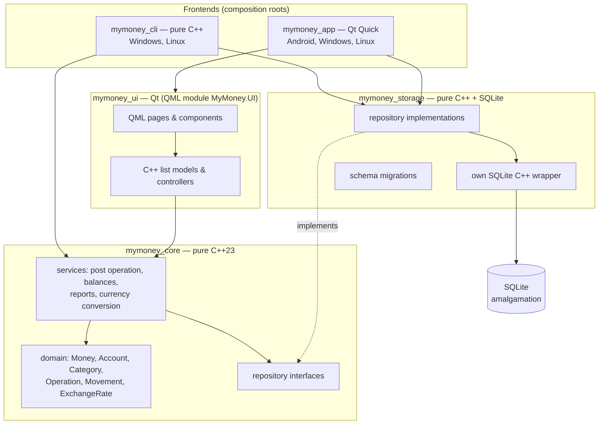
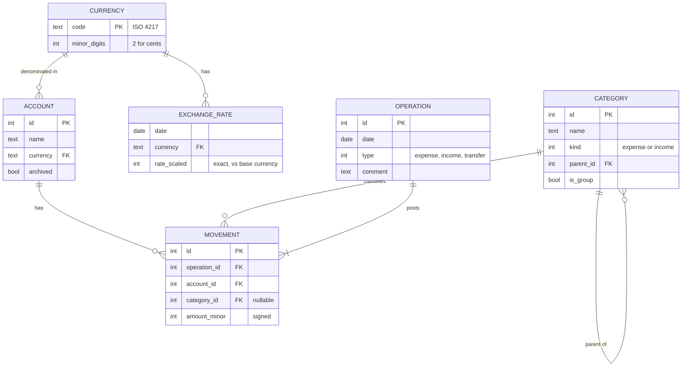

# MyMoney — Project Plan and System Design

> **Status:** draft v0.5 · 2026-10-19
> **Type:** personal learning project
>
> This document is a *living plan*. Update it when a decision is made or a milestone is finished.
> Every decision has an ID (`D1`, `D2`, …) — section 11 lists them all.
> Accepted decisions are recorded as ADRs in [`docs/adr/`](adr/).

---

## 0. How we work

**The rule of this project: design first, then code.** Claude writes the code, but only
after the design of that piece has been discussed and agreed. No code without an agreed design.
For every milestone (or bigger feature):

1. **Discuss** — Claude presents the design options and trade-offs; you ask questions and decide.
2. **Record** — the decision goes into an ADR in `docs/adr/` and its status into section 11.
3. **Implement** — Claude writes the code in small, reviewable steps on a milestone branch.
4. **Explain** — Claude walks you through the important parts; you should be able to explain
   every part yourself. If something is unclear, it is discussed before moving on.
5. **Verify** — you build and run it on the targets; tests must pass.
6. **Merge** — you review the diff and merge (or ask Claude to commit/merge).

---

## 1. Description

**MyMoney** is a personal finance tracker: it records income, expenses and transfers between
your accounts (cash, bank cards, savings — in different currencies), shows balances, and
reports where the money goes by category and period.

It replaces a personal finance app built on 1C:Enterprise and used daily since 2012.
The new version is a native C++ application: a **Qt Quick UI on Android** (main use) and
a **command-line interface on PC**, sharing the same pure C++ core. The full history
since 2012 is migrated from the old app.

### 1.1 Goals

**Product goals**

- Replace the old app for daily use: adding an expense on the phone takes < 10 seconds.
- Keep all data local, in a single file that you own and can back up.
- Migrate the full history since 2012.

**Learning goals** (equally important — this is why the project exists)

| Area | What you want to learn |
|---|---|
| Modern C++ | C++23 value types, `std::chrono`, `std::expected`, ranges, templates, RAII, testing |
| Data | SQL, SQLite and its C API, schema design, migrations, transactions |
| Architecture | layers, interfaces, dependency injection, ADRs |
| Qt Quick / QML | declarative UI, bindings, Qt Quick Controls, navigation, touch UI |
| Qt ↔ C++ integration | `QObject`, properties, signals/slots, `QML_ELEMENT`, list models |
| Build | modern CMake, Qt CMake API, presets, `FetchContent`, multi-platform builds |
| Android | deployment, APK signing, app storage, debugging on device |
| Engineering | git workflow, GoogleTest, code review, clang-format/clang-tidy, CI |

### 1.2 Non-goals (at least for v1)

- No publishing to Google Play, no other users.
- No automatic bank synchronization.
- No cloud server. Sync between devices is a *later* topic (D14).
- No iOS / macOS.
- No budgets (never used in the old app).

---

## 2. Target platforms

| Platform | Frontend | Role | Kit / toolchain | Device |
|---|---|---|---|---|
| **Android arm64** | Qt Quick UI | main daily use | `Qt 6.12.0 for Android arm64-v8a` | physical Pixel 6 (Android 17, API 37) |
| Android x86_64 | Qt Quick UI | fast testing on PC | `Qt 6.12.0 for Android x86_64` | emulator `Pixel6` (API 37) |
| **Windows x64** | CLI + Qt Quick UI | main *development* platform | MSVC (VS 2026) + Qt 6.12.0 | local PC |
| **Linux x64** | CLI + Qt Quick UI | portability | GCC 15 + Qt 6.12 in WSL (Ubuntu 26.04 LTS) | WSL / WSLg |

Android: Qt 6.12 defaults — **minSdk 28** (Android 9), **targetSdk 37** (Android 17). Kept as is.

**UI rule:** the Qt Quick UI is designed **phone-first** (portrait, touch, about 400 × 850 dp).
On the desktop it runs in a phone-sized window.

---

## 3. Feature scope

### 3.1 MVP (v1.0) — "can replace the old app"

- **Accounts** — create / edit / archive; each account has one currency.
- **Categories** — expense and income categories; root-level *groups* hold categories,
  only categories hold operations (max depth 2, ADR-0015).
- **Operations** — expense, income, transfer between accounts (also cross-currency).
- **Journal** — list of operations, filter by period / account / category.
- **Income & expense report** — by category hierarchy, **per currency**;
  filters: currency, category, account, date range.
- **Balances** — current balance per account, and in a chosen currency **with conversion**
  (exchange rates — D21).
- **Exchange rates** — downloaded from a public source for a configurable list of currencies,
  manually or automatically on app start; manual entry as a fallback.
- **Import** of the full history from the old app.
- **Backup** — export / import of the database file.
- **CLI** on PC for all of the above (except backup UI).

### 3.2 Later

- **Balance history** in a chosen currency (not MVP — decided 2026-10-16).
- **Account tags** — user-defined tags on accounts (e.g. "liquid") for grouping and totals.
  There is deliberately no fixed account type: the name says what an account is.
- **Labels** — tags on operations (e.g. "vacation 2026.08"), filter in reports. Not MVP, maybe never.
- Charts (Qt Graphs).
- Recurring / planned operations.
- Search.
- App lock with PIN / biometrics.
- Sync between phone and PC (D14).

---

## 4. System design

### 4.1 Architecture overview

Layers, each a separate CMake target. A target can only include headers of targets it links
to, so the compiler *enforces* the dependency rules.



**Dependency rule:** arrows point *inward*. `core` depends on nothing but the C++ standard
library. `storage` depends on `core` and SQLite. `ui` depends on `core` and Qt. `storage` and
`ui` never depend on each other. Only the two composition roots (`cli`, `app`) know all layers
and connect them.

**Qt is used only in `ui` and `app`** (ADR-0002, ADR-0007). `core`, `storage`, `cli` and all
unit tests build without Qt.

### 4.2 Layer responsibilities

| Layer | Contains | Must NOT contain | Tested by |
|---|---|---|---|
| **core** | value types (`Money`, `CurrencyCode`), entities, business rules (operation shapes, category depth, archived accounts), repository *interfaces*, services (posting, balances, reports, conversion) | SQL, Qt, file paths, I/O | GoogleTest with in-memory fake repositories |
| **storage** | SQLite C++ wrapper (connection, statements, transactions), repository implementations, migrations | business rules, Qt | GoogleTest against SQLite `:memory:` |
| **cli** | command parsing, text output, 1C import command | business rules, SQL | GoogleTest for parsing; manual use |
| **ui** | QML; C++ list models and form controllers that call services | SQL, business rules | manual; later Qt Quick Test |
| **app** | `main()`: open DB, create services, start QML engine | anything else | — |

### 4.3 Domain model

Ledger model **B — operations and movements** ([ADR-0006](adr/0006-ledger-model-operations-and-movements.md)).



| Operation type | Movements |
|---|---|
| expense | 1 — negative, expense category |
| income | 1 — positive, income category |
| transfer | 2 — negative on source, positive on target, no category; different currencies → independent amounts |

- **Balance** of an account at a date = sum of its movements up to that date.
- **Converted balance** = balance × rate of that date (latest rate on or before it) —
  [ADR-0009](adr/0009-exchange-rates-for-balance-reports.md), *proposed*.
- **Income/expense report** = sums of movements grouped by category tree and currency.
- The exact table and column design is done in M2 (D4, D7).

### 4.4 Data storage

[ADR-0007](adr/0007-sqlite-with-own-cpp-wrapper.md): **SQLite** (amalgamation, pinned version),
accessed through an **own C++23 wrapper** over the C API. No Qt SQL.

- **Wrapper:** RAII types for the connection, prepared statements and transactions;
  type-safe parameter binding with variadic templates; errors as `std::expected`.
- **File location:** chosen by the frontend and passed to `storage` as a path.
  The Qt app uses `QStandardPaths::AppDataLocation` (Android: app-private storage);
  the CLI uses a command-line option or a default per-user path.
- **Migrations:** numbered SQL scripts; schema version in `PRAGMA user_version`;
  applied in one transaction on startup (D7).
- **Integrity:** `PRAGMA foreign_keys = ON`; posting an operation is one SQL transaction.
- **Money:** `INTEGER` minor units. **Never** `REAL`/`double`. Exchange rates: exact
  integer-scaled values.

### 4.5 QML ↔ C++ integration

- C++ types registered with `QML_ELEMENT` / `QML_SINGLETON` and `qt_add_qml_module`.
  No `setContextProperty`.
- Lists: C++ classes derived from `QAbstractListModel`, filled from `core` services.
- Forms: controller objects with `Q_PROPERTY`s, a `valid` property and `Q_INVOKABLE save()`.
- Services created in `app/main.cpp` and injected (D12).
- Conversions at the border: `std::string` (UTF-8) ↔ `QString`,
  `std::chrono::year_month_day` ↔ `QDate`, `Money` → formatted text with `QLocale`.

### 4.6 Cross-cutting concerns

| Concern | Approach |
|---|---|
| **Code style** | Google C++ Style Guide — [ADR-0008](adr/0008-google-cpp-style.md); clang-format + clang-tidy |
| **Errors** | no exceptions; `std::expected<T, Error>`; assertions for broken invariants (ADR-0008) |
| **Money** | `Money { int64 minor units; CurrencyCode }`; arithmetic only within one currency |
| **Dates** | business date = calendar date without time zone (`std::chrono::year_month_day`); technical timestamps in UTC |
| **Text** | `std::string` with UTF-8; MSVC builds with `/utf-8` |
| **Logging** | `core`/`storage`: a small logging interface (D23); `ui`: Qt logging categories → `adb logcat` on Android |
| **Localization** | UI strings in `qsTr()` from the start (D19) |

### 4.7 Old app → new app (orientation only)

The design is chosen on its own merits, not copied from the old app. This table only helps
to map familiar concepts:

| 1C:Enterprise | MyMoney |
|---|---|
| Configuration (metadata) | SQL schema + migrations |
| Catalog | table + entity (`Account`, `Category`) |
| Document | `Operation` |
| Posting | `OperationService::Post()` in one DB transaction |
| Accumulation register | `movement` table + sums |
| Information register (rates) | `exchange_rate` table |
| Common module | services in `core` |

---

## 5. Development environment and tools

Installed and verified (2026-10-12/13):

| Tool | Version | Purpose |
|---|---|---|
| Windows 11 | 10.0.26200 | host OS — all development happens here |
| Qt | **6.12.0** (MSVC 2022 x64, Android arm64/x86_64; MinGW, armv7, x86 installed but unused) | UI framework |
| Qt Creator | **20.0.2** | IDE, debugger, Android deployment |
| MSVC | Visual Studio Community 2026 (18.1) | desktop compiler |
| CDB | Windows Kits 10 | desktop debugger |
| CMake / Ninja (Windows) | **3.30.5** / **1.12.1** from the Qt installer (`C:\Qt\Tools`) — used by Qt Creator. Visual Studio also bundles CMake **4.3.1**. None of them is on `PATH`. Which CMake to use and the minimum version → M0 design | build system |
| JDK | Temurin 17.0.20 | Android build (Gradle) |
| Android SDK | platform 37, build-tools, cmdline-tools 23.0, emulator | Android build & run |
| Android NDK | 27.2.12479018 (clang 18.0.3, libc++) | Android C++ compiler |
| Android emulator | AVD `Pixel6`, API 37, x86_64, host GPU, WHPX | testing on PC |
| Git | 2.54 · GitHub `RomantsovS/MyMoneyCPP` | version control |
| WSL2 | **Ubuntu 26.04.1 LTS** (distro `Ubuntu-26.04`, installed 2026-10-16, replaces 24.04), systemd, WSLg; Git 2.53, GCC **15.2**, CMake **4.2.3**, Ninja 1.13.2 (installed; M2 builds and tests pass there) | Linux builds |

To set up later:

| Tool | When | Purpose |
|---|---|---|
| `.clang-format`, `.clang-tidy` | M0 | formatting, naming, static analysis (ADR-0008) |
| `qmllint`, `qmlformat` | M4 | QML checks (in `C:\Qt\6.12.0\msvc2022_64\bin`) |
| DB Browser for SQLite *(optional)* | M2 | inspect the database file |
| Build tools + Qt 6.12 in WSL (Ubuntu 26.04) | M10 | Linux build |

> **Lesson from the setup:** Android tooling breaks when versions drift
> (cmdline-tools 23 vs Qt Creator 18 — QTCREATORBUG-34917).
> Keep the versions in `README.md`, so the environment can be rebuilt.

---

## 6. Dependencies

**Principle:** Qt only for the UI. Every third-party library is a decision with a cost
(build on all platforms, Android cross-compile, updates).

| Dependency | Used by | How it is obtained |
|---|---|---|
| C++23 standard library | all | toolchain |
| **SQLite** (amalgamation) | `storage` | CMake `FetchContent` or vendored in `third_party/`, pinned version (decided in M2) |
| **GoogleTest / GoogleMock** | tests | CMake `FetchContent`, pinned tag (ADR-0003) |
| Command-line parser (D22) | `cli` | open: hand-written, CLI11, Abseil flags, … |
| Qt Core, Qml, Quick, Quick Controls | `ui`, `app` | Qt installer |
| Qt Graphs *(later)* | `ui` | Qt installer |
| Qt Linguist tools *(later)* | `ui` | Qt installer |

No package manager (vcpkg / Conan) — not needed for this small set.

---

## 7. Project directory hierarchy

```
MyMoney/
├── CMakeLists.txt            # top level: project(VERSION), options, pure C++ part, then Qt part
├── CMakePresets.json         # command-line presets: windows/linux, debug/release, no-UI
├── CMakeUserPresets.json     # local only (git-ignored): Qt path of this machine
├── README.md                 # what it is, how to build, exact tool versions
├── .gitignore  .gitattributes
├── .clang-format             # BasedOnStyle: Google
├── .clang-tidy               # checks + Google naming
│
├── cmake/
│   ├── CompilerOptions.cmake # mymoney_compile_options INTERFACE target, mymoney_target_defaults()
│   └── Dependencies.cmake    # FetchContent: GoogleTest (SQLite from M2)
│
├── docs/
│   ├── PROJECT_PLAN.md       # this file
│   └── adr/                  # Architecture Decision Records
│
├── src/
│   ├── core/                 # mymoney_core (static lib) — pure C++23
│   │   ├── CMakeLists.txt
│   │   ├── version.h, version.cpp.in   # generated from project(VERSION)
│   │   ├── money.h / money.cpp
│   │   ├── account.h, category.h, operation.h, exchange_rate.h …
│   │   ├── repositories/     # interfaces: account_repository.h, operation_repository.h …
│   │   └── services/         # operation_service, balance_service, report_service …
│   │
│   ├── storage/              # mymoney_storage (static lib) — pure C++23 + SQLite (from M2)
│   │   ├── CMakeLists.txt
│   │   ├── sqlite/           # own wrapper: database.h, statement.h, transaction.h
│   │   ├── migrations/       # 0001_initial.sql, …
│   │   └── sqlite_account_repository.h / .cpp …
│   │
│   ├── cli/                  # mymoney_cli (executable "mymoney-cli") — pure C++23
│   │   ├── CMakeLists.txt
│   │   ├── main.cpp          # composition root
│   │   └── commands/         # account, operation, report, balance, import …
│   │
│   ├── ui/                   # mymoney_ui (static lib) — Qt, QML module "MyMoney.UI"
│   │   ├── CMakeLists.txt
│   │   ├── .clang-tidy       # inherits the root config, relaxes rules that conflict with Qt
│   │   ├── models/           # account_list_model.h/.cpp …
│   │   ├── controllers/      # operation_editor.h/.cpp …
│   │   └── qml/
│   │       ├── Main.qml
│   │       ├── pages/        # AccountsPage.qml, JournalPage.qml …
│   │       └── components/   # MoneyField.qml, CategoryPicker.qml …
│   │
│   └── app/                  # mymoney_app (executable "MyMoney") — Qt
│       ├── CMakeLists.txt    # also the Android package settings
│       └── main.cpp          # composition root
│
├── android/                  # later: AndroidManifest.xml, res/ (icons) — not needed in M0
│
└── tests/                    # one test executable per layer
    ├── CMakeLists.txt
    ├── core/                 # mymoney_core_tests: version_test.cpp, money_test.cpp …
    ├── storage/              # mymoney_storage_tests: SQLite ":memory:"
    └── cli/                  # mymoney_cli_tests
```

Notes:

- File names: `snake_case.h` / `snake_case.cpp` (ADR-0011 — `.cpp` instead of Google's `.cc`).
  QML files keep the QML convention (`PascalCase.qml`), because the file name is the QML type name.
- Includes are written from `src/`: `#include "core/version.h"` (Google style: path from the
  project's source root). Header guards follow the same path: `MYMONEY_CORE_VERSION_H_`.
- **The Qt part is optional in the build:** `MYMONEY_BUILD_UI=OFF` builds only the pure C++
  targets — no Qt needed.
- Build directories: `build/<preset>/` inside the repo (git-ignored), or Qt Creator's own.

---

## 8. Build configurations

| Configuration | Toolchain | Builds | Used for |
|---|---|---|---|
| Desktop Debug | MSVC x64 | everything | daily work, tests, debugging |
| Desktop Debug, no UI | MSVC x64 | core, storage, cli, tests | fast loop for non-UI work |
| Desktop Release | MSVC x64 | everything | CLI for daily use on PC |
| Android x86_64 Debug | Qt Android x86_64 | core, storage, ui, app | emulator |
| Android arm64 Debug | Qt Android arm64-v8a | core, storage, ui, app | phone testing |
| Android arm64 Release (signed) | Qt Android arm64-v8a | core, storage, ui, app | daily use (M9) |
| Linux Debug | GCC 15 in WSL | everything | portability (M10) |

---

## 9. Quality and workflow

- **Git:** small commits; one branch per milestone (`m2-storage`), merged into `master` when
  "done when" is met.
- **Tests:** every business rule in `core` and every repository in `storage` has tests.
- **Review:** you review every diff before merge; bigger milestones also get a `/code-review`.
- **Style:** clang-format on save; clang-tidy clean (ADR-0008).
- **Warnings:** `/W4 /permissive-` (MSVC); `-Wall -Wextra -Wpedantic -Wshadow -Wconversion
  -Wsign-conversion -Wold-style-cast -Wnon-virtual-dtor` (clang/GCC); warnings are errors in
  all our own targets, never in third-party code (ADR-0011).
- **Sanitizers:** AddressSanitizer + UBSan runs in WSL from time to time.
- **CI (M10):** GitHub Actions — Windows + Linux build and tests, Android APK build.

---

## 10. Milestones (roadmap)

Each milestone is small enough for a few evenings. "Learn" lists the topics we discuss.

### M0 — Skeleton runs everywhere — ✅ done 2026-10-16
- **Build:** CMake structure, presets, compiler options, `.gitattributes`, `.gitignore`,
  `.clang-format`, `.clang-tidy`; `core` with the generated version; `mymoney-cli --version`;
  GoogleTest with a first test; a QML window showing the version on desktop, emulator and phone;
  Android package ID, name and version set in CMake. No `storage` yet (M2).
- **Learn:** CMake targets and presets, `FetchContent`, generated files (`configure_file`),
  `qt_add_executable`, `qt_add_qml_module` (static modules + plugins), how an APK is built,
  kits vs presets, clang-format/clang-tidy.
- **Done when:** the same commit builds and runs on all targets; tests run in Qt Creator.
- **Decisions:** D17 ✔, D18 ✔, D20 ✔, M0 build decisions ✔ ([ADR-0011](adr/0011-build-system-and-skeleton.md)).

### M1 — Domain core — ✅ done 2026-10-18
- **Build:** `Money`, `CurrencyCode`, `Account`, `Category` (depth rule), `Operation` +
  `Movement` (shape rules), repository interfaces, `OperationService` with in-memory fakes.
- **Learn:** value types, `operator<=>`, `constexpr`, strong types, overflow-safe arithmetic,
  `std::expected`, interfaces and dependency injection without a framework, GoogleTest/GoogleMock.
- **Done when:** all business rules from ADR-0006 are covered by tests.
- **Decisions:** D2 ✔, D3 ✔, D4 ✔, D5 ✔, D16 ✔, D23 ✔ — design in [ADR-0012](adr/0012-domain-model.md).

### M2 — Storage — ✅ done 2026-10-18
- **Build:** SQLite wrapper; migrations; repositories for currencies, accounts, categories,
  operations + movements; posting in one transaction.
- **Learn:** SQLite C API, RAII for C handles, variadic templates for binding, SQL basics
  (`CREATE TABLE`, `JOIN`, `GROUP BY`, `WITH RECURSIVE`), transactions, `PRAGMA user_version`.
- **Done when:** tests post operations into `:memory:` and read correct balances; migrations
  on an existing DB are a no-op.
- **Decisions:** D6 ✔, D7 ✔ — design in [ADR-0013](adr/0013-storage-design.md).

### M3 — CLI — ✅ done 2026-10-18
- **Build:** `mymoney_cli` commands: accounts, categories, add operation, journal, balances,
  income/expense report.
- **Learn:** command-line design, argument parsing (D22), text tables, exit codes, composition root.
- **Done when:** you can run a test month of your finances through the CLI only.
- **Decisions:** D22 ✔ — design in [ADR-0014](adr/0014-cli-design.md).

### M3b — Category groups — ✅ done 2026-10-19
- **Decided 2026-10-18 (option B, "folders and files"):** a category *group* only contains
  categories and never has operations; a *category* has operations and never has children.
  Groups exist only at the root (max depth 2); a category is at the root or inside a group of
  the same kind; names are unique across groups and categories.
- **Build:** `Category::is_group`; service rules; migration `0003` (column, conversion of
  M3 data, triggers); fakes mirror the triggers; CLI `group add <name> --kind K`,
  `category add <name> [--group NAME] [--kind K]` (replaces `--parent`), groups marked in
  `category list`.
- **Learn:** SQLite triggers and `RAISE`, `ALTER TABLE ADD COLUMN`, data migrations.
- **Done when:** the M3 test database migrates without losing an operation; operations on
  groups are refused by the service and by the database.
- **Decisions:** D25 ✔ — design in [ADR-0015](adr/0015-category-groups.md).

### M4 — First UI: accounts and balances
- **Build:** Qt Quick app with accounts page (list with balances, total), add/edit account.
- **Learn:** `QAbstractListModel` and roles, `QML_ELEMENT`, `ListView`, Qt Quick Controls,
  `StackView`, bindings, C++ ↔ QML type conversions.
- **Done when:** you can create accounts on the phone; data survives app restart.
- **Decisions:** D10, D11, D12, D19.

### M5 — Entering operations (UI)
- **Build:** expense / income / transfer form; category picker; amount input.
- **Learn:** form controllers, `Q_PROPERTY` + `NOTIFY`, validation, Android keyboard behaviour.
- **Done when:** adding an expense on the phone takes < 10 seconds.

### M6 — Journal (UI)
- **Build:** operations list with filters; edit and delete.
- **Learn:** filtering in SQL vs proxy models; model updates after edits; date sections.
- **Done when:** a month of test data is easy to browse on the phone.

### M7 — Reports and currency conversion
- **Build:** exchange rates (storage, download from the chosen source, manual entry);
  income/expense report by category tree per currency; current balances in a chosen currency.
- **Learn:** aggregate SQL and recursive queries, exact decimal arithmetic for rates,
  interfaces for external services (`RateSource`), HTTP with Qt Network, parsing a provider's
  response format, report UI (tree / table), Qt Graphs basics (optional).
- **Done when:** reports match the same period in the old app.
- **Decisions:** D21.

### M8 — Import from the old app
- **Build:** export from the 1C app; `mymoney_cli import` command; level-3 categories merged
  into their parents; exchange rates imported if available.
- **Learn:** JSON/CSV parsing, ID mapping, idempotent import, data validation.
- **Done when:** the full history since 2012 is in MyMoney and the balances match.
- **Decisions:** D15.

### M9 — Ready for daily use on Android
- **Build:** backup/restore of the DB file, app icon, signed release APK on the phone.
- **Learn:** Android storage model, file sharing on Android, signing, release vs debug.
- **Done when:** you use MyMoney instead of the old app for one week without problems.
- **Decisions:** D13.

### M10 — Linux and CI
- **Build:** Linux build in WSL (GCC 15); GitHub Actions for Windows/Linux + Android APK.
- **Learn:** portability, CI pipelines, artifacts.
- **Done when:** every push is built and tested automatically.

### Later
Balance history (if not in M7), labels, charts, recurring operations, PIN lock, sync (D14),
translations (D19).

---

## 11. Decisions

*Status:* ☐ open · ◐ in discussion / partly decided · ☑ decided (with ADR)

| ID | Question | Before | Status |
|---|---|---|---|
| D1 | MVP scope | M0 | ☑ section 3 (2026-10-13) |
| D2 | Ledger model | M1 | ☑ B, operations + movements — [ADR-0006](adr/0006-ledger-model-operations-and-movements.md) |
| D3 | Multi-currency | M1 | ☑ yes — [ADR-0004](adr/0004-multi-currency-from-start.md), amended by D21 |
| D4 | ID type | M1 | ☑ int64 from storage, strong ID types — [ADR-0012](adr/0012-domain-model.md) |
| D5 | Qt in `core`? | M1 | ☑ no, pure C++23 — [ADR-0002](adr/0002-core-is-pure-cpp23.md) |
| D6 | Storage technology and access | M2 | ☑ SQLite + own C++ wrapper — [ADR-0007](adr/0007-sqlite-with-own-cpp-wrapper.md) |
| D7 | Migrations and date storage | M2 | ☑ embedded `.sql` files + `user_version`; ISO TEXT dates — [ADR-0013](adr/0013-storage-design.md) |
| D8 | Test framework | M1 | ☑ GoogleTest — [ADR-0003](adr/0003-googletest.md) |
| D9 | C++ standard | M0 | ☑ C++23; GCC 15 on Linux — [ADR-0002](adr/0002-core-is-pure-cpp23.md) |
| D10 | Visual style | M4 | ☐ |
| D11 | Navigation and desktop layout | M4 | ☐ |
| D12 | How QML gets C++ objects | M4 | ☐ |
| D13 | Backup strategy | M9 | ☐ |
| D14 | Sync between devices | later | ☐ |
| D15 | Import format and details | M8 | ◐ in M8; level-3 categories merged into parents |
| D16 | Error handling | M1 | ☑ no exceptions, `std::expected` — [ADR-0008](adr/0008-google-cpp-style.md) |
| D17 | Code style | M0 | ☑ Google C++ Style — [ADR-0008](adr/0008-google-cpp-style.md) |
| D18 | Name, package ID, repo | M0 | ☑ [ADR-0005](adr/0005-android-package-id.md) |
| D19 | UI language(s) | M4 | ☐ |
| D20 | How to record decisions | M0 | ☑ ADRs — [ADR-0001](adr/0001-record-decisions-as-adrs.md) |
| D21 | Exchange rates and conversion | M7 | ◐ proposed, only the rate source open — [ADR-0009](adr/0009-exchange-rates-for-balance-reports.md) |
| D22 | CLI argument parsing | M3 | ☑ hand-written parser + command table — [ADR-0014](adr/0014-cli-design.md) |
| D23 | Logging in pure C++ layers | M1 | ☑ none; frontends log — [ADR-0012](adr/0012-domain-model.md) |
| D24 | Build system and M0 skeleton | M0 | ☑ [ADR-0011](adr/0011-build-system-and-skeleton.md) |
| D25 | Category groups | M3b | ☑ groups hold categories, categories hold operations — [ADR-0015](adr/0015-category-groups.md) |

### Open decisions

**D4 — ID type.** INTEGER autoincrement (simple) or UUID (needed for merging data from
several devices — D14). *Recommendation:* INTEGER now; a `uuid` column can be added if sync comes.

**D7 — Migrations and date storage.** Numbered `.sql` scripts embedded in the binary +
`PRAGMA user_version`. Dates as ISO `TEXT` (`YYYY-MM-DD`) or integer day numbers.
*Recommendation:* `.sql` scripts, ISO `TEXT`.

**D10 — Visual style.** Qt Quick Controls Material (native look on Android), Basic, Fusion,
or a custom style. *Recommendation:* Material, light + dark.

**D11 — Navigation.** Bottom tabs (Accounts · Journal · Reports) + `StackView` per tab, or a
`Drawer` menu. *Recommendation:* bottom tabs; same layout on desktop for now.

**D12 — How QML gets C++ objects.**
(A) engine-created singletons — simple, but they must find services themselves (global state);
(B) objects created in `main.cpp`, exposed with `QML_SINGLETON` + static `create()` factory —
explicit dependency injection, type-checked;
(C) properties of the root window via `setInitialProperties` — explicit, but passed down by hand;
(D) context properties — old style, avoid. *Recommendation:* B.

**D13 — Backup.** Manual export of the DB file via Android share sheet; import back.
Android deletes app data on uninstall — this must exist before daily use (M9).

**D14 — Sync (later).** Copy the DB file manually; change export/import; a small server.
Affects D4.

**D15 — Import.** Export format from the 1C app (JSON is probably the easiest to write
in 1C), import labels into a table without UI or drop them, exchange-rate history.

**D19 — UI language(s).** English, another language, or both. `qsTr()` from the start anyway.

**D21 — Exchange rates.** Decided (2026-10-16): download from the internet, configurable
currency list, manual + on app start; rates stored as published (no global base currency;
display currency chosen per report); balance history not MVP. Open: which rate source —
see ADR-0009.

**D22 — CLI argument parsing.** Hand-written (learning, no dependency), CLI11 (popular,
header-only), Abseil flags (Google family, heavy), cxxopts (small).

**D23 — Logging in `core`/`storage`.** These layers have no Qt. Options: no logging (errors
are returned as values), a small logging interface implemented by each frontend, or a library
(spdlog, Abseil log). *Recommendation:* a small interface — errors are values anyway.

---

## 12. Risks

| Risk | Impact | Mitigation |
|---|---|---|
| Data loss on the phone (uninstall, phone lost) | **high** | backup before daily use (M9); keep the old app until MyMoney is proven |
| Import mismatches (14 years of edge cases) | wrong balances | compare balances per account and date with the old app (M8) |
| Exchange-rate precision and missing rates | wrong converted totals | exact arithmetic, clear "latest rate on or before" rule, tests (M7) |
| Tooling breaks after updates (already happened once) | lost evenings | pin versions in README; update deliberately |
| Qt 6.12.0 is a fresh `.0` release | small bugs | update to 6.12.x patch releases |
| Scope creep | never reach daily use | strict MVP (section 3.1) |
| Code is written faster than it is understood | nothing is learned | design discussion before code, walkthrough after (section 0) |

---

## 13. Glossary

| Term | Meaning |
|---|---|
| **ABI** | CPU architecture of a binary: `arm64-v8a` (phone), `x86_64` (emulator, PC) |
| **ADR** | Architecture Decision Record — `docs/adr/` |
| **Amalgamation** | SQLite distributed as one C source file, `sqlite3.c` |
| **AVD** | Android Virtual Device — an emulator configuration |
| **Composition root** | the one place (`main`) where all objects are created and connected |
| **Kit** | Qt Creator: Qt version + compiler + debugger + device |
| **Minor units** | the smallest unit of a currency: cents |
| **Migration** | a script that changes the DB schema from version N to N+1 |
| **Movement** | one signed change of one account's balance, created by an operation |
| **Operation** | what the user enters: an expense, income, or transfer |
| **Repository** | an interface for loading/saving domain objects, hiding the storage technology |
