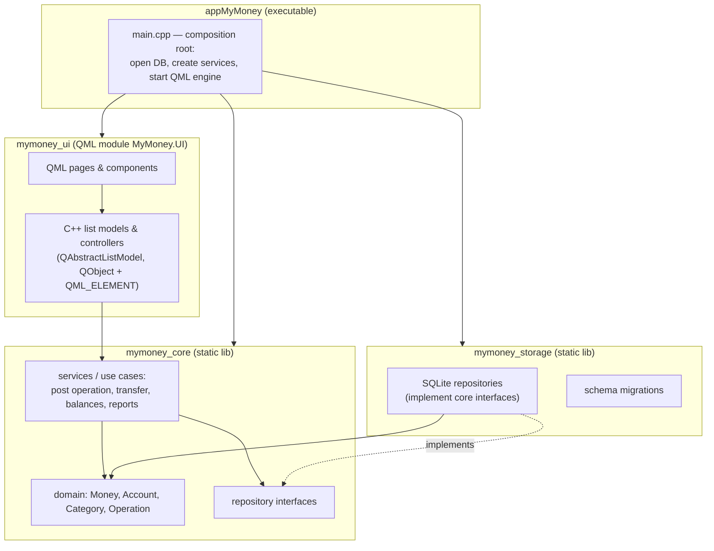
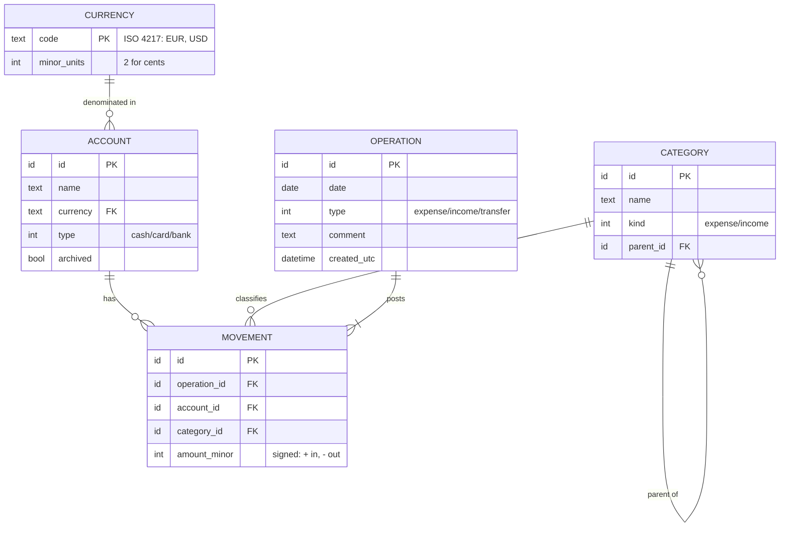

# MyMoney — Project Plan and System Design

> **Status:** draft v0.2 · 2026-10-13
> **Type:** personal learning project
>
> This document is a *living plan*. Update it when you make a decision or finish a milestone.
> Every decision has an ID (`D1`, `D2`, …) — section 11 lists them all.

---

## 0. How to use this document

1. Read sections 1–9 once to get the big picture.
2. Go through **section 11 (Decisions)** and make the decisions marked *"before M0"*.
3. Work milestone by milestone (section 10). Each milestone says what you build,
   what you learn, and how you know you are done.
4. When you make a decision, write a short ADR in `docs/adr/` (see D20) and update its status here.

**The rule of this project: design first, then code.** Claude writes the code, but only
after the design of that piece has been discussed and agreed. No code without an agreed design.
For every milestone (or bigger feature):

1. **Discuss** — Claude presents the design options and trade-offs; you ask questions and decide.
2. **Record** — the decision goes into an ADR in `docs/adr/` and its status into section 11.
3. **Implement** — Claude writes the code in small, reviewable steps on a milestone branch.
4. **Explain** — Claude walks you through the important parts; you should be able to explain
   every part yourself. If something is unclear, it is discussed before moving on.
5. **Verify** — you build and run it on the targets; tests must pass.
6. **Merge** — you review the diff and merge (or ask Claude to commit/merge).

---

## 1. Description

**MyMoney** is a personal finance tracker: it records income, expenses and transfers between
your accounts (cash, bank cards, savings), shows the balance of each account, and reports
where the money goes by category and period.

It is the second generation of the **MyMoney** app that you built on the 1C:Enterprise
platform and still use. The new version is a native C++/Qt application that runs on your
**Android phone** first, and also on **Windows** and **Linux**.

### 1.1 Goals

**Product goals**

- Replace the 1C version for daily use: adding an expense on the phone must take < 10 seconds.
- Keep all data local, in a single file that you own and can back up.
- Import historical data from the 1C version (so the history is not lost).

**Learning goals** (equally important — this is why the project exists)

| Area | What you want to learn |
|---|---|
| Modern C++ | C++20/23 value types, `std::chrono` dates, `std::expected`/error handling, ranges, testing |
| Qt Quick / QML | declarative UI, bindings, Qt Quick Controls, navigation, touch UI |
| Qt ↔ C++ integration | `QObject`, properties, signals/slots, `QML_ELEMENT`, list models |
| Data | SQLite through Qt SQL, schema design, migrations, transactions |
| Build | modern CMake, Qt CMake API (`qt_add_qml_module`), presets, multi-platform builds |
| Android | deployment, APK/AAB, signing, app storage, permissions, debugging on device |
| Engineering | git workflow, unit tests, code review, CI, architecture decision records |

### 1.2 Non-goals (at least for v1)

- No publishing to Google Play, no other users.
- No automatic bank synchronization (bank APIs are complicated and country-specific).
- No cloud server. Sync between devices is a *later* topic (D14).
- No iOS / macOS.

---

## 2. Target platforms

| Platform | Role | Kit in Qt Creator | Device |
|---|---|---|---|
| **Android arm64** | main target, daily use | `Qt 6.12.0 for Android arm64-v8a` | physical Pixel 6 (Android 17, API 37) |
| Android x86_64 | fast testing on PC | `Qt 6.12.0 for Android x86_64` | emulator `Pixel6` (API 37) |
| **Windows x64** | main *development* platform; also usable as a desktop app | `Desktop Qt 6.12.0 MSVC2022 64bit` | local PC |
| **Linux x64** | secondary; proves portability | Qt 6.12 + GCC 13.3 in WSL (Ubuntu 24.04) | WSLg window |

Android versions: Qt 6.12 defaults to **minSdk 28** (Android 9) and **targetSdk 37** (Android 17).
Since this is only for your phone, you can keep these defaults.

**UI rule:** the UI is designed **phone-first** (portrait, touch, about 400 × 850 dp).
On the desktop the same UI runs in a phone-sized window. A separate desktop layout is optional,
later (D11).

---

## 3. Feature scope

The exact MVP depends on how you use the 1C version today — that is **D1**, the first decision.
A proposal:

### 3.1 MVP (v1.0) — "can replace the 1C app on the phone"

- **Accounts** — create / edit / archive (cash, card, bank account, savings). Each account has a currency.
- **Categories** — expense and income categories, two levels (e.g. *Food → Restaurants*).
- **Operations** — expense, income, transfer between accounts; date, amount, account, category, comment.
- **Journal** — list of operations, newest first, filter by period / account / category.
- **Balances** — current balance of each account and the total.
- **Monthly report** — expenses by category for a month.
- **Backup** — export the database file / import it back (critical on Android, see risks).

### 3.2 Later (v1.x, v2)

- Import from the 1C version (could also be in v1 — D15).
- Multiple currencies with exchange rates and a "total in main currency" (D3).
- Charts (Qt Graphs).
- Budgets per category and month.
- Recurring / planned operations.
- Search, tags.
- App lock with PIN / biometrics.
- Sync between phone and PC (D14).

---

## 4. System design

### 4.1 Architecture overview

A layered design. Each layer is a separate CMake target, so the compiler *enforces* the rules
(a target cannot include headers from a target it does not link to).



**Dependency rule:** arrows point *inward*. `core` depends on nothing of ours
(and on as little Qt as possible — D5). `storage` and `ui` depend on `core`, never on each other.
Only `app/main.cpp` knows all layers and connects them.

### 4.2 Layer responsibilities

| Layer | Contains | Must NOT contain | Tested by |
|---|---|---|---|
| **core** | value types (`Money`, `Date`), entities, business rules (a transfer moves the same amount between two accounts; an archived account cannot get new operations), repository *interfaces*, services | SQL, QML, file paths, `QObject` UI glue | fast unit tests with fake (in-memory) repositories |
| **storage** | `QSqlDatabase` connection, SQL queries, mapping rows ↔ domain objects, migrations | business rules, UI | tests against SQLite `:memory:` DB |
| **ui** | QML files; C++ models that expose data to QML; controllers for forms (validation, "Save") | SQL, business rules | manual testing; later Qt Quick Test |
| **app** | `main()`: create objects, wire them, load `Main.qml` | anything else | — |

### 4.3 Domain model (conceptual)

If you know 1C, you already know this design (see the mapping table in 4.7).
A proposal for D2 = "documents + movements":



- An **operation** is what the user enters (like a 1C *document*).
- **Movements** are what the operation *changes* (like records of a 1C *accumulation register*).
  An expense creates 1 movement (−amount on the account). A transfer creates 2 movements
  (−amount on the source account, +amount on the target account).
- **Balance of an account** = `SUM(amount_minor)` of its movements. You may cache it later
  if it becomes slow (it will not — a personal DB has about 10⁴–10⁵ rows).

### 4.4 Data storage

- **Engine:** SQLite, accessed through **Qt SQL** (`QSQLITE` driver, built into Qt on all platforms) — D6.
- **File location:** `QStandardPaths::writableLocation(QStandardPaths::AppDataLocation)/mymoney.sqlite`.
  On Android this is the app's private storage; on Windows it is in `%APPDATA%`.
- **Migrations:** numbered SQL scripts (`001_initial.sql`, `002_add_budgets.sql`, …) embedded as
  Qt resources. The current schema version is stored in SQLite's `PRAGMA user_version`.
  On startup: read the version and apply the missing scripts inside one transaction — D7.
- **Integrity:** `PRAGMA foreign_keys = ON`; posting an operation (operation + movements) is one
  SQL transaction — it either fully succeeds or does nothing.
- **Money column:** `INTEGER` in minor units (cents). **Never** `REAL`/`double`.
- **Date column:** `TEXT` in ISO format `YYYY-MM-DD` (sorts correctly, readable in DB tools)
  — or an integer day number; small decision inside D7.

### 4.5 QML ↔ C++ integration

- C++ types are registered **declaratively** with `QML_ELEMENT` / `QML_SINGLETON` macros and
  `qt_add_qml_module` — the modern Qt 6 way. Avoid the old `setContextProperty` approach.
- Lists in QML (`ListView`) get their data from C++ classes derived from `QAbstractListModel`
  (e.g. `AccountListModel`, `OperationListModel`). You will learn roles, `dataChanged`,
  `beginInsertRows`/`endInsertRows`.
- Forms (e.g. "new expense") use a C++ **controller** object with `Q_PROPERTY`s for the fields,
  a `valid` property, and a `Q_INVOKABLE bool save()`. The QML is "dumb": it only shows fields
  and calls `save()`.
- Services are **injected** into models/controllers (by constructor or by a singleton that
  `main.cpp` sets up) — D12.

### 4.6 Cross-cutting concerns

| Concern | Approach |
|---|---|
| **Money** | Own value type: `Money { std::int64_t minor; CurrencyCode currency; }`. Arithmetic only between the same currency. Formatting with `QLocale` in the UI layer only. |
| **Dates** | Business date of an operation = a calendar date without time zone (`std::chrono::year_month_day` or `QDate` — D5). Technical timestamps (`created_utc`) in UTC. |
| **Errors** | One consistent style across layers — D16. |
| **Logging** | `qDebug`/`qInfo`/`qWarning` with logging categories (`Q_LOGGING_CATEGORY`), e.g. `mymoney.storage`. On Android they appear in `adb logcat`. |
| **Localization** | Wrap all UI strings in `qsTr()` from day one, even if there is only one language — D19. |
| **Code style** | `.clang-format` + `.clang-tidy`; naming convention — D17. |

### 4.7 1C:Enterprise → MyMoney concept mapping

| 1C:Enterprise | In this project |
|---|---|
| Configuration (metadata) | SQL schema + migration scripts |
| Catalog (Справочник) | table + C++ entity: `Account`, `Category` |
| Document (Документ) | `Operation` |
| Posting a document (Проведение) | `OperationService::post()` — writes operation + movements in one DB transaction |
| Accumulation register (Регистр накопления) | `movement` table + balance/turnover queries |
| Register "balances" virtual table | `SELECT account_id, SUM(amount_minor) … GROUP BY account_id` |
| Common module / manager module | services in `core` |
| List form / object form | QML page + `QAbstractListModel` / controller |
| Report (СКД) | report service + SQL with `GROUP BY` + QML table/chart |
| Infobase (file mode) | the single SQLite file |

---

## 5. Development environment and tools

Already installed and verified on 2026-10-12:

| Tool | Version | Purpose |
|---|---|---|
| Windows 11 | 10.0.26200 | host OS — all development happens here |
| Qt | **6.12.0** (MSVC 2022 x64, Android arm64/x86_64; MinGW, armv7, x86 also installed but unused) | framework |
| Qt Creator | **20.0.2** | IDE, debugger frontend, Android deployment |
| MSVC | Visual Studio Community 2026 (18.1) | desktop compiler |
| CDB | Windows Kits 10 | desktop debugger |
| CMake / Ninja | 3.30.5 / 1.12.1 (from Qt installer) | build system |
| JDK | Temurin 17.0.20 | Android build (Gradle) |
| Android SDK | platform 37, build-tools, cmdline-tools 23.0, emulator | Android build & run |
| Android NDK | 27.2.12479018 (clang 18.0.3) | Android C++ compiler |
| Android emulator | AVD `Pixel6`, API 37, x86_64, host GPU, WHPX | testing on PC |
| Git | 2.54 | version control |
| WSL2 | Ubuntu 24.04, GCC 13.3, CMake 3.28 | Linux builds |

To set up (part of M0):

| Tool | Purpose |
|---|---|
| Git repository + remote (GitHub private repo? — D18) | history, backup of the code, later CI |
| `clang-format`, `clang-tidy` | formatting and static analysis (Qt Creator ships them with its Clang Code Model) |
| `qmllint`, `qmlformat` | QML linting and formatting (shipped with Qt, in `C:\Qt\6.12.0\msvc2022_64\bin`) |
| DB Browser for SQLite *(optional)* | look inside the database file while debugging |
| Qt for Linux in WSL | Qt online installer for Linux, or `aqtinstall` — in M9 |

> **Lesson from the setup:** Android tooling breaks when versions drift
> (cmdline-tools 23 vs Qt Creator 18 — QTCREATORBUG-34917).
> Keep the table above up to date in `README.md`, so the environment can be rebuilt.

---

## 6. Dependencies

**Principle:** start with **Qt only**. Every third-party library is a decision with a cost
(build on 3 platforms, Android cross-compile, updates). Add one only when Qt cannot do the job.

| Library / Qt module | Used for | Layer |
|---|---|---|
| Qt Core | `QString`, `QDate`, containers, `QObject`, logging, `QStandardPaths` | storage, ui, (core — D5) |
| Qt Sql + SQLite plugin | database access | storage |
| Qt Qml, Qt Quick | QML engine, UI | ui |
| Qt Quick Controls | ready-made controls; Material style — D10 | ui |
| Qt Test | unit tests — D8 | tests |
| Qt Quick Test *(later)* | QML tests | tests |
| Qt Linguist tools *(later)* | translations — D19 | ui |
| Qt Graphs *(later, M6)* | charts in reports | ui |
| Qt Svg *(maybe)* | SVG icons | ui |
| **Third-party** | *none planned.* Possible later: GoogleTest/Catch2 (D8), SQLCipher (DB encryption). | — |

No package manager (vcpkg / Conan) is needed while all dependencies come from Qt.

---

## 7. Project directory hierarchy

```
MyMoney/
├── CMakeLists.txt            # top level: project(), find_package(Qt6 …), add_subdirectory(…)
├── CMakePresets.json         # named configurations: desktop debug/release, android, linux
├── README.md                 # what it is, how to build, exact tool versions
├── .gitignore
├── .clang-format
├── .clang-tidy
│
├── docs/
│   ├── PROJECT_PLAN.md       # this file
│   ├── adr/                  # Architecture Decision Records (D20)
│   │   └── 0001-ledger-model.md
│   └── learning-log.md       # optional: what you learned, problems you hit
│
├── src/
│   ├── core/                 # target: mymoney_core (static lib) — no UI, no SQL
│   │   ├── CMakeLists.txt
│   │   ├── Money.h / .cpp
│   │   ├── Account.h, Category.h, Operation.h
│   │   ├── repositories/     # interfaces: IAccountRepository.h, IOperationRepository.h …
│   │   └── services/         # OperationService, BalanceService, ReportService
│   │
│   ├── storage/              # target: mymoney_storage (static lib)
│   │   ├── CMakeLists.txt
│   │   ├── Database.h / .cpp # open file, PRAGMAs, run migrations
│   │   ├── SqlAccountRepository.h / .cpp …
│   │   └── migrations/       # 001_initial.sql, 002_….sql  (embedded as resources)
│   │
│   ├── ui/                   # target: mymoney_ui — QML module "MyMoney.UI"
│   │   ├── CMakeLists.txt    # qt_add_qml_module(mymoney_ui URI MyMoney.UI …)
│   │   ├── models/           # AccountListModel, OperationListModel …
│   │   ├── controllers/      # OperationEditor, AccountEditor …
│   │   └── qml/
│   │       ├── Main.qml
│   │       ├── pages/        # AccountsPage.qml, JournalPage.qml, ReportPage.qml …
│   │       └── components/   # MoneyField.qml, CategoryPicker.qml …
│   │
│   └── app/                  # target: appMyMoney (executable)
│       ├── CMakeLists.txt
│       └── main.cpp          # composition root
│
├── android/                  # QT_ANDROID_PACKAGE_SOURCE_DIR: AndroidManifest.xml, res/ (icons)
├── resources/                # shared icons, fonts
│
├── tests/
│   ├── CMakeLists.txt        # enable_testing(), one executable per test file
│   ├── core/                 # tst_money.cpp, tst_operationservice.cpp …
│   └── storage/              # tests on SQLite ":memory:"
│
└── tools/
    └── import-1c/            # importer for data exported from the 1C version (M7)
```

Notes:

- **One CMake target per folder in `src/`.** `target_link_libraries` defines who may use whom —
  this is how the dependency rule in 4.1 is enforced by the compiler.
- Headers live next to sources (Qt style). A separate `include/` tree is useful for libraries
  that you publish — not needed here.
- Build directories (`build/`, `build-*`) are **outside** the source tree or ignored by git.
  The source tree is identical for all platforms.

---

## 8. Build configurations

| Configuration | Kit | Used for |
|---|---|---|
| Desktop Debug | MSVC 2022 x64 | 90 % of daily work: write code, run tests, debug |
| Desktop Release | MSVC 2022 x64 | occasional check; optional desktop use |
| Android x86_64 Debug | Android x86_64 | check on the emulator: touch, screen size, Android behaviour |
| Android arm64 Debug | Android arm64-v8a | real device testing |
| Android arm64 Release (signed) | Android arm64-v8a | the APK that you actually use every day (M8) |
| Linux Debug | GCC 13 in WSL | portability check (M9) |

Tests run on the **desktop** kit (fast). The `core` and `storage` code is the same on all platforms.

---

## 9. Quality and workflow

- **Git:** small commits; one branch per milestone (`m2-storage`), merged when "done when" is met.
- **Tests:** `core` and `storage` are developed test-first or test-alongside. Target: every
  business rule has a test. UI is tested manually at first.
- **Review:** you review every diff before it is merged; for bigger milestones also run
  `/code-review` for a second look, then fix or consciously accept the findings.
- **Warnings:** compile with high warning level (`/W4` on MSVC, `-Wall -Wextra` on clang/GCC);
  treat warnings as errors in `core` and `storage`.
- **Sanitizers:** run tests with AddressSanitizer on MSVC or in WSL (GCC) from time to time.
- **CI (M9):** GitHub Actions builds and tests on Windows + Linux, and builds the Android APK.

---

## 10. Milestones (roadmap)

Each milestone is small enough for a few evenings. **"Learn"** is as important as **"Build"**.

### M0 — Skeleton runs everywhere
- **Build:** git repo; top-level CMake + `CMakePresets.json`; an empty QML window ("Hello MyMoney")
  that runs on desktop, emulator and the phone. Package name and app name set (D18).
- **Learn:** `qt_standard_project_setup`, `qt_add_executable`, `qt_add_qml_module`; how Qt builds
  an APK (androiddeployqt, Gradle); kits vs presets; `adb logcat`.
- **Done when:** the same commit runs on all three targets; `README.md` has build steps.
- **Decisions before:** D1, D17, D18, D20 (and roughly D2).

### M1 — Domain core: Money and entities
- **Build:** `mymoney_core` with `Money`, `CurrencyCode`, `Account`, `Category`, `Operation`;
  unit tests.
- **Learn:** value semantics, `operator<=>`, `constexpr`, strong types, overflow checking, the
  test framework, CTest integration in Qt Creator.
- **Done when:** `Money` cannot be added across currencies (compile error or checked error —
  your choice); tests are green; no Qt UI/SQL headers in `core`.
- **Decisions before:** D2, D3, D4, D5, D8, D9, D16.

### M2 — Storage
- **Build:** `mymoney_storage`: open DB, migrations, repositories for accounts, categories,
  operations + movements; posting in one transaction.
- **Learn:** `QSqlDatabase`/`QSqlQuery`, prepared statements, SQL transactions, `PRAGMA
  user_version`, foreign keys, testing with `:memory:`.
- **Done when:** tests create a DB, post a transfer, and read correct balances; re-running
  migrations on an existing DB is a no-op.
- **Decisions before:** D6, D7.

### M3 — First UI: accounts and balances
- **Build:** accounts page (list with balances, total), add/edit account.
- **Learn:** `QAbstractListModel` and roles, `QML_ELEMENT`, `ListView` + delegates, Qt Quick
  Controls, `StackView` navigation, bindings vs imperative code.
- **Done when:** you can create accounts on the phone; data survives app restart.
- **Decisions before:** D10, D11, D12.

### M4 — Entering operations
- **Build:** "new expense / income / transfer" form; category picker; amount input.
- **Learn:** controller objects with `Q_PROPERTY` + `NOTIFY`, input validation, Android
  virtual keyboard behaviour, locale-aware number input.
- **Done when:** adding an expense on the phone takes < 10 seconds.

### M5 — Journal and filters
- **Build:** operations list, newest first; filter by period/account/category; edit and delete.
- **Learn:** filtering in SQL vs `QSortFilterProxyModel`; model updates after edits;
  section headers by date.
- **Done when:** a month of real test data is easy to browse on the phone.

### M6 — Reports
- **Build:** expenses by category for a month; optional chart with Qt Graphs.
- **Learn:** aggregate SQL, report service design, Qt Graphs basics.
- **Done when:** the report matches the same month in the 1C version.

### M7 — Import from 1C
- **Build:** export data from the 1C app (CSV/XML/JSON — D15) and import it.
- **Learn:** file parsing (`QXmlStreamReader`/`QJsonDocument`/CSV), ID mapping, idempotent import.
- **Done when:** your full history is in MyMoney and the balances match 1C.

### M8 — Ready for daily use on Android
- **Build:** backup/restore (export DB file via Android share sheet / file picker), app icon,
  release build signed with your own key, installed on the phone.
- **Learn:** Android storage model, `QStandardPaths`, intents/file dialogs on Android, signing,
  release vs debug differences.
- **Done when:** you use MyMoney instead of 1C for one week without problems.

### M9 — Linux and CI
- **Build:** Linux build in WSL; GitHub Actions for Windows/Linux builds + tests + Android APK.
- **Learn:** portability (GCC vs MSVC differences), CI pipelines, artifacts.
- **Done when:** every push is built and tested automatically.

### Later
Multi-currency (if not in MVP), budgets, recurring operations, PIN lock, sync (D14),
translations (D19), desktop-specific layout (D11).

---

## 11. Decisions to make

Overview — details below. *Status:* ☐ open · ☑ decided (link the ADR).

| ID | Question | Decide before | Status |
|---|---|---|---|
| D1 | What is in the MVP? | M0 | ◐ mostly answered 2026-10-13 — see notes below |
| D2 | Ledger model | M1 | ☐ in discussion — decide on its own merits, not because 1C does it |
| D3 | Multi-currency in MVP? | M1 | ☑ yes, per-currency totals, no rates — [ADR-0004](adr/0004-multi-currency-from-start.md) |
| D4 | ID type | M1 | ☐ |
| D5 | Does `core` use Qt types? | M1 | ☑ no, pure C++23 — [ADR-0002](adr/0002-core-is-pure-cpp23.md) |
| D6 | Database / storage technology and access | M2 | ☐ in discussion — SQL vs document DB; own DB interface wanted |
| D7 | Migrations and date storage | M2 | ☐ |
| D8 | Test framework | M1 | ☑ GoogleTest — [ADR-0003](adr/0003-googletest.md) |
| D9 | C++ standard | M0/M1 | ☑ C++23; GCC 14 on Linux — [ADR-0002](adr/0002-core-is-pure-cpp23.md) |
| D10 | Visual style | M3 | ☐ |
| D11 | Navigation and desktop layout | M3 | ☐ |
| D12 | How QML gets C++ objects | M3 | ☐ |
| D13 | Backup strategy | M8 | ☐ |
| D14 | Sync between devices | later | ☐ |
| D15 | 1C import format; in v1? | M7 | ☐ |
| D16 | Error handling style | M1 | ☐ |
| D17 | Naming and formatting style | M0 | ◐ snake_case, `private_member_`; details open |
| D18 | App name, package ID, repo hosting | M0 | ☑ [ADR-0005](adr/0005-android-package-id.md) |
| D19 | UI language(s) | M3 | ☐ |
| D20 | How to record decisions | M0 | ☑ ADRs — [ADR-0001](adr/0001-record-decisions-as-adrs.md) |

**D1 notes (2026-10-13), from the current usage of the 1C app since 2012:**
accounts in several currencies (→ D3); sub-categories — 1C uses depth 3, the new app needs 2;
labels (operation tags, e.g. "vacation 2026.08") — *not* MVP, maybe never;
main report — income and expenses by category hierarchy, filters: currency, category,
account, date (+ label later); budgets — never used; full history must be migrated (D15).

### D1 — What is in the MVP?
Write down what you *actually use* in the 1C version every week. Everything else goes to "later".
Questions: Do you use several currencies? Sub-categories? Tags/projects? Planned payments?
Budgets? Which reports do you look at?
*Recommendation:* section 3.1, adjusted to your real usage.

### D2 — Ledger model
- **A. Simple transactions:** one table; a transfer has `from_account` and `to_account`.
  Easiest; balances need `CASE` logic in SQL.
- **B. Operations + movements (1C style):** see 4.3. Every operation posts signed movements;
  balance = `SUM`. Clean, extensible, familiar to you from 1C.
- **C. Full double-entry bookkeeping:** every movement has a debit and a credit side;
  categories are accounts too. Most powerful, most theory.

*Recommendation:* **B.** You already understand it from 1C, so you can focus on C++/Qt.

### D3 — Multi-currency in MVP?
Do you have accounts in different currencies *today*? If yes, the model must support it from M1
(currency per account; transfers between currencies have two amounts). Exchange rates and
"total in main currency" can still come later.
*Recommendation:* currency per account and `Money` with currency from M1 (cheap now, expensive
to add later); rates later.

### D4 — ID type
- **INTEGER autoincrement:** simple, fast, readable.
- **UUID:** needed if you ever *merge* data from two devices (sync) or import repeatedly
  without duplicates.

*Recommendation:* INTEGER primary keys + an optional `uuid` column added when you need sync (D14).

### D5 — Does the `core` layer use Qt types?
- **A. Pure standard C++** (`std::string`, `std::chrono::year_month_day`, `std::vector`):
  `core` is portable and teaches modern standard C++; the UI layer converts to `QString`/`QDate`.
- **B. Qt Core allowed** (`QString`, `QDate`, `QList`): less conversion code, consistent with
  the rest of the app.

*Recommendation:* **A** for the learning value — but it costs some conversion code at the
borders. B is perfectly fine for a Qt app. Your choice.

### D6 — Database access library
- **A. Qt SQL** (`QSqlDatabase`, `QSqlQuery`): built in, works on Android out of the box.
- **B. sqlite3 C API directly:** learn SQLite deeply; you need to wrap it in RAII yourself.
- **C. A C++ ORM / query builder** (sqlite_orm, sqlpp11): type safety, but an extra dependency
  and hidden SQL.

*Recommendation:* **A.**

### D7 — Migrations and date storage
Migrations: numbered `.sql` files + `PRAGMA user_version` (proposed in 4.4), or C++ migration
functions. Dates: ISO `TEXT` or integer day number.
*Recommendation:* `.sql` files embedded as resources; ISO `TEXT` dates.

### D8 — Test framework
- **A. Qt Test:** built in, integrates with Qt Creator, good for Qt types; macro style is
  a bit old-fashioned.
- **B. GoogleTest:** industry standard (you may know it from work); Qt Creator supports it;
  extra dependency (via CMake `FetchContent`).
- **C. Catch2:** modern, nice syntax; extra dependency.

*Recommendation:* **A** (no dependencies), or **B** if you already use it at work and want
the same habits.

### D9 — C++ standard
All three compilers support most of **C++23** core language (MSVC 18.1, clang 18 in NDK 27,
GCC 13), but the standard libraries differ: e.g. `std::expected` is everywhere, while
`std::print` is **missing in GCC 13's libstdc++** (WSL).
*Recommendation:* `CMAKE_CXX_STANDARD 23`, but use only features that work on all three
compilers — your Linux build (M9) will tell you if you didn't.

### D10 — Visual style
Qt Quick Controls styles: **Material** (looks native on Android, also fine on desktop),
**Basic**, **Fusion**, or your own custom style.
*Recommendation:* Material, light + dark theme.

### D11 — Navigation and desktop layout
Phone: `StackView` (push/pop pages) + bottom `TabBar` or a `Drawer` menu.
Desktop: the same phone layout in a narrow window, or a wider two-pane layout later.
*Recommendation:* bottom tabs (Accounts · Journal · Reports) + `StackView` per tab;
same layout on desktop for now.

### D12 — How QML gets C++ objects
- **A. Singletons created by the QML engine** (`QML_SINGLETON` with a default constructor) —
  simple, but the singleton must then find the services itself (global state).
- **B. Objects created in `main.cpp`, exposed as singletons** (`QML_SINGLETON` + a static
  `create(QQmlEngine*, QJSEngine*)` factory that returns the object you built) — explicit
  dependency injection, still type-checked by the QML tooling.
- **C. Objects passed as properties of the root window** (`setInitialProperties`) — explicit,
  but you must pass them down the page hierarchy by hand.
- **D. Context properties** (`setContextProperty`) — old style, slower and not type-checked;
  avoid.

*Recommendation:* create services in `main.cpp`, expose them through one or a few
`QML_SINGLETON` "backend" objects. We will look at the exact pattern together in M3 —
it is one of the most important Qt Quick concepts.

### D13 — Backup strategy
Android deletes app data when the app is uninstalled. Options: manual export of the DB file
(share sheet → Google Drive / e-mail / PC), automatic export to a user-chosen folder,
Android Auto Backup.
*Recommendation:* manual export + import in M8 at the latest; automatic later.

### D14 — Sync between devices (later)
Not needed for v1. Possible later: copy the DB file manually; export/import of changes;
a small server. Affects D4 (UUIDs). Just keep it in mind.

### D15 — 1C import: format and timing
Which export can your 1C app produce most easily (CSV, XML, JSON)? One-time import or repeated?
Before v1 (so you can switch completely) or after?

### D16 — Error handling style
- **A. Exceptions** — idiomatic standard C++; but Qt itself does not use them and they must
  not cross into the Qt event loop / QML.
- **B. `std::expected<T, Error>`** (C++23) — explicit, no hidden control flow; a bit verbose.
- **C. Qt style:** `bool` return + `QString* errorMessage`, or `std::optional`.

*Recommendation:* **B** in `core`/`storage`, converted to user-visible messages in the
controllers. Good learning value. Exceptions only for programmer errors (or `Q_ASSERT`).

### D17 — Naming and formatting style
- Qt style: `camelCase` functions, `m_member`, `PascalCase` classes — matches Qt API.
- std style: `snake_case` everywhere.

*Recommendation:* Qt style (the code touches Qt everywhere); clang-format based on the
Qt Creator / WebKit style or your work style.

### D18 — App name, package ID, repository
- Name: **MyMoney** (decided earlier).
- Android package ID (permanent once installed): proposal `io.github.romantsovs.mymoney`
  (reverse domain of your GitHub Pages address, which you own).
- Repository: ☑ GitHub `RomantsovS/MyMoneyCPP`, branch `master` (decided 2026-10-13).

### D19 — UI language(s)
English only, another language only, or both? Use `qsTr()` from the start anyway;
adding a translation later is then easy (Qt Linguist).

### D20 — How to record decisions
*Recommendation:* lightweight **ADRs** — one Markdown file per decision in `docs/adr/`:
*Context · Options · Decision · Consequences* (10–20 lines). In half a year you will not
remember *why* — the ADR will.

---

## 12. Risks

| Risk | Impact | Mitigation |
|---|---|---|
| Data loss on the phone (uninstall, phone broken/lost) | **high** — it's your financial history | backup in M8 at the latest (D13); keep the 1C app until MyMoney is proven |
| Tooling breaks after updates (we already hit one) | lost evenings | pin versions in README; update Qt/SDK deliberately, not automatically |
| Qt 6.12.0 is a fresh `.0` release | small bugs | update to 6.12.x patch releases when they come |
| Scope creep ("one more feature") | never reach daily use | strict MVP (D1); "later" list in section 3.2 |
| Code is written faster than it is understood | the project works, but nothing is learned | design discussion before code, walkthrough after (section 0); small milestones; you must be able to explain each part |
| Floating-point money bugs | wrong balances | `int64` minor units only; tests for rounding/overflow |

---

## 13. Glossary

| Term | Meaning |
|---|---|
| **ABI** | CPU architecture of a binary: `arm64-v8a` (phone), `x86_64` (emulator, PC) |
| **ADR** | Architecture Decision Record |
| **AVD** | Android Virtual Device — an emulator configuration |
| **Kit** | Qt Creator: Qt version + compiler + debugger + device |
| **Minor units** | the smallest unit of a currency: cents, kopecks |
| **Migration** | a script that changes the DB schema from version N to N+1 |
| **Movement** | one signed change of one account's balance, created by posting an operation |
| **Operation** | what the user enters: an expense, income, or transfer |
| **QML module** | a set of QML files + C++ types under one import URI, built by `qt_add_qml_module` |
